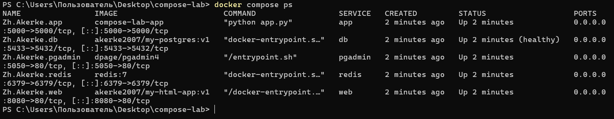

## 4. Docker Compose: сайт + база данных + приложение

Репозиторийде сайт (`Dockerfile`, `index.html`), база (`db/`) және приложение (`app/`) бар. Бір командамен 5 контейнер көтеріледі: сайт (nginx), PostgreSQL, Flask приложение, pgAdmin және Redis.

### Іске қосу (3 команда)

```bash
git clone https://github.com/zhanbajakerke-tech/DockerSro.git
cd DockerSro
docker compose up -d --build
```

Тексеру: `docker compose ps`

| Контейнер | Сервис | Порт |
|-----------|--------|------|
| Zh.Akerke.web | сайт (nginx) | 8080 |
| Zh.Akerke.db | PostgreSQL + таблица students | 5433 |
| Zh.Akerke.app | Flask приложение (дб-дан оқиды) | 5000 |
| Zh.Akerke.pgadmin | pgAdmin 4 | 5050 |
| Zh.Akerke.redis | Redis | 6379 |

Тоқтату: `docker compose down`

